# Margam (मार्गम् / మార్గం)
> **Every learner has a path. Find yours.**  
> *Adaptive Mathematics Learning & Explainable Prerequisite Remediation Platform for Indian Classes 6–10*

[](https://kernel2k26.vercel.app)
[](https://nextjs.org/)
[](https://www.typescriptlang.org/)
[](#visual-design-system--pixel-art-theme)
[](#curriculum-dag--mathematics-chains)
[](#multilingual-support--translation-workflow)
[](#privacy-student-safety--dpdp-act)
[](#server-side-security--zero-client-secret-leaks)
[](#automated-testing--validation-suite)

---

## 1. Executive Summary & Core Philosophy

**Margam** is an intelligent, explainable mathematics remediation platform designed for Indian middle and high school students (Classes 6 to 10). Built for **Code Kernel '26**, Margam solves a foundational challenge in Indian classrooms: **mathematics is cumulative**. When a student struggles with Class 10 Quadratic Equations or Class 9 Polynomials, the root breakdown is almost always an unaddressed misconception from middle school (such as integer sign distribution or fraction arithmetic).

Instead of superficial practice drills or generic chatbots, Margam provides:
1. **Explainable Prerequisite Backtracking:** When a student errs, Margam evaluates mistake patterns across a Directed Acyclic Graph (DAG) to isolate foundational gaps up to 3 grades prior.
2. **Three-Stage Adaptation:**
   - **Stage 1 (Diagnostic):** Low-stakes diagnostic test isolating specific conceptual gaps.
   - **Stage 2 (Solve / Adaptive Practice):** Stepped practice (Difficulty 1–3) with bespoke mistake-creature feedback.
   - **Stage 3 (Chapter Test):** Rigorous blueprint-constrained summative assessment with weak/strong concept partitioning.
3. **Three Pedagogical Lesson Styles:** Every concept offers *Basics-First* (intuitive real-world models), *Standard* (rigorous NCERT steps), and *Fast-Track* (high-speed visual summaries).
4. **Privacy-by-Design & Zero Surveillance:** Full adherence to India's **DPDP Act 2023**—no emails, no phone numbers, and no advertising trackers.
5. **Zero Client Bundle Leaks:** Answer keys and distractor mistake tags are 100% stripped from client JavaScript bundles and evaluated strictly via server-side cryptographically signed sessions.

---

## 2. Complete Architecture & Feature Matrix

```mermaid
graph TD
    User([Student / Teacher]) --> WebApp[Next.js 14 App Router]
    
    subgraph ClientLayer ["Client Presentation (Pixel-Art UI)"]
        Landing["Landing Page (Hero, Cat Mascot)"]
        DiagUI["Diagnostic & Gap Card ('Fix this first')"]
        LessonUI["3-Style Lesson Switcher"]
        PracticeUI["Adaptive Practice (Difficulty 1-3 & Mistake SVGs)"]
        TestUI["Summative Chapter Test"]
        StickersUI["Gamified Sticker Badges"]
        AuthUI["Email-Free Student & Teacher Login"]
    end
    
    subgraph ServerLayer ["Server Security & API Routes"]
        DiagAPI["POST /api/diagnostic/start & submit"]
        PracticeAPI["POST /api/practice/start & submit"]
        TestAPI["POST /api/test/start & submit"]
        AuthAPI["POST /api/auth/student-signup & login"]
        RateLimiter["Server Sliding-Window Rate Limiter"]
        SessionSigner["HMAC-SHA256 Short-Lived Session Signer"]
        LockoutGuard["15-Min Failed Login Lockout"]
    end

    subgraph DataLayer ["Data Stores & Knowledge Base"]
        DAG["NCERT DAG (concepts.json - 20 nodes)"]
        QBank["Chapter Split Questions (data/questions/*.json)"]
        Taxonomy["Misconception Mappings (tag-roots.json)"]
        Supabase["PostgreSQL + Row-Level Security (RLS)"]
        LocalStorage["Client Dual-Mode Offline Storage"]
    end

    WebApp --> ClientLayer
    ClientLayer --> ServerLayer
    ServerLayer --> DataLayer
```



---

## 3. Curriculum DAG & Mathematics Chains

Margam covers all **67 official NCERT Mathematics chapters** across Classes 6 to 10, featuring two complete 5-grade pilot remediation chains:

```
[PILOT CHAIN 1: Integers to Quadratic Equations]
Class 6: Negative Numbers (c6-neg-01) 
   └──> Class 7: Integer Multiplication & Signs (c7-int-02) 
           └──> Class 8: Distributive Property & Binomials (c8-dist-01) 
                   └──> Class 9: Algebraic Identities & Factoring (c9-id-01) 
                           └──> Class 10: Quadratic Equations (c10-quad-01)

[PILOT CHAIN 2: Sequences to Polynomial Zeroes]
Class 6: Patterns in Sequences & Shapes (c6-pat-01) 
   └──> Class 7: Arithmetic Expressions & BODMAS (c7-alg-01) 
           └──> Class 8: Laws of Exponents & Powers (c8-exp-01) 
                   └──> Class 9: Terms & Zeroes of Polynomials (c9-poly-01) 
                           └──> Class 10: Geometrical Meaning of Zeroes (c10-poly-01)
```

### Question Bank & Content Metrics:
- **121 Original Multiple-Choice Questions** (9 questions per core pilot concept: 3 Difficulty-1, 3 Difficulty-2, 3 Difficulty-3).
- **4 Options Each (`A`, `B`, `C`, `D`)**:
  - `correctAnswer`: Exact numerical/algebraic solution.
  - Distractors: Every incorrect option has a concrete cognitive mistake tag linked to root misconceptions in `tag-roots.json`.
- **253 Curated Mistake Tags** mapped to ancestor remedial concepts.
- **20 Three-Variant Lessons** (60 bespoke learning experiences in English, Hindi, and Telugu).

---

## 4. Visual Design System — Pixel Art Theme

Margam features an authentic, retro 16-bit blocky video game aesthetic with zero external font CDNs:
- **Typography:** Self-hosted *Press Start 2P* pixel font for English headings, buttons, and badges.
- **Pixel Palette (WCAG AA Compliant):**
  - **Grass Green (`#5DB84A`)** & **Dark Grass (`#3C8A2E`)**: Primary actions, success indicators, and growth metrics.
  - **Dirt Brown (`#8B5A2B`)**: Earthy foundational cards and structural outlines.
  - **Stone Grey (`#9AA0A6`)**: Inactive states, borders, and neutral cards.
  - **Sand Yellow (`#F2D16B`)**: Highlights, tooltips, and star ratings.
  - **Sky Blue (`#7EC8E3`)**: Navigation, hints, and informational chips.
  - **Redstone Red (`#D9453D`)**: Mistake creatures and error alerts.
  - **Ink (`#111111`)**: Deep high-contrast borders and typography.
- **Physical Feedback:** 4px hard block drop-shadows with 4px active translation states on clicks.
- **Witch Cat Companion (*Maru*):** Interactive animated SVG mascot responding to time of day, diagnostic progress, and user achievements.
- **Mistake Creatures:** Handcrafted SVG pixel creatures visualizing specific cognitive slips (*Sign Slip*, *Fraction Fumble*, *Distribution Dodge*, *Calculation Slip*).

---

## 5. Server-Side Security & Zero Client Secret Leaks

To ensure academic honesty and tamper-resistance:
1. **Answer Key Stripping:** Client bundles contain zero instances of `correctAnswer` or `mistakeTag`.
2. **Server-Side Grading:** Diagnostics, practice questions, and chapter tests are validated exclusively via backend server routes (`/api/diagnostic/*`, `/api/practice/*`, `/api/test/*`).
3. **Signed Sessions:** Test requests receive short-lived HMAC-SHA256 session tokens. A student cannot tamper with question parameters or grade another student's attempt.
4. **Rate Limiting:** Sliding-window rate limiters block automated submission spam or brute-forcing.

---

## 6. Privacy, Student Safety & DPDP Act

Adhering strictly to India's **Digital Personal Data Protection (DPDP) Act 2023**:
- **Email-Free Student Registration:** Students choose a unique username and password. Synthetic unrouteable addresses (`username@student.margam.local`) are generated internally for Supabase Auth compatibility. No personal email or phone number is ever requested.
- **One-Time Recovery Codes:** Students receive a 16-character recovery code (`XXXX-XXXX-XXXX-XXXX`) upon signup, stored only as a deterministic SHA-256 hash.
- **Teacher Consent Verification:** Teachers verify school or guardian consent during registration.
- **Row-Level Security (RLS):**
  - Students can only view and update their own attempts and mastery data.
  - Teachers can only view profiles and mastery of students enrolled in their assigned classes.
- **Server Lockout:** 5 consecutive failed login attempts trigger an automatic, server-enforced **15-minute account lockout**.

---

## 7. Multilingual Support & Translation Workflow

All official chapters, concepts, learning objectives, questions, options, hints, explanations, and lessons are localized across three languages:
- **English** (`en`)
- **Hindi** (`hi`)
- **Telugu** (`te`)

### Translation Review Tooling:
- **Export Script (`scripts/export-translations.mjs`)**:
  Exports all 2,834 Hindi and Telugu strings into `translations-review.csv` with unique compound IDs and English source text:
  ```bash
  node scripts/export-translations.mjs
  ```
- **Import Script (`scripts/import-translations.mjs`)**:
  Reads the corrected CSV, applies text corrections, and updates `reviewed: true` exclusively for rows marked approved by language reviewers:
  ```bash
  node scripts/import-translations.mjs translations-review.csv
  ```

---

## 8. Automated Testing & Validation Suite

Margam incorporates a complete test suite covering curriculum DAG acyclicity, deterministic mathematical correctness, RLS security policies, and production bundle isolation:

| Command | Suite | Purpose |
| :--- | :--- | :--- |
| `npm run validate` | **Content & Math Validation** | Verifies DAG acyclicity (DFS), 121 question schemas, 253 mistake tags, and 121 deterministic math answers. |
| `npm run test:auth` | **Security & RLS Suite** | Simulates PostgreSQL RLS policies, teacher scoping, student cross-isolation, and 15-minute lockouts. |
| `npm run test:bundle` | **Bundle Secret Audit** | Scans production `.next/static` JavaScript and HTML files to verify zero client answer leaks. |
| `npm run smoke` | **E2E Visual Smoke Test** | Headless Playwright test verifying 60 screenshots across EN, HI, and TE at 360x800 and desktop resolutions. |
| `npm test` | **Master Test Runner** | Executes all progression, gap tracing, adaptive engine, and authentication tests. |

---

## 9. Setup & Local Development

### Prerequisites
- **Node.js:** `v20.x` or later
- **npm:** `v10.x` or later

### Installation
```bash
# 1. Clone the repository
git clone https://github.com/shalinireddy67/kernel2k26.git
cd kernel2k26

# 2. Install dependencies
npm install

# 3. Run validation and security tests
npm run validate
npm run test:auth

# 4. Start the development server
npm run dev
```

Open [http://localhost:3000](http://localhost:3000) to access Margam locally.

---

## 10. Deployment on Vercel

Margam is configured for continuous production deployment on Vercel.

Live URL: **[https://kernel2k26.vercel.app](https://kernel2k26.vercel.app)**

### Environment Variables
Configure the following in Vercel Project Settings:
```env
NEXT_PUBLIC_APP_NAME="Margam"
NEXT_PUBLIC_DEFAULT_LOCALE="en"
NEXT_PUBLIC_SHOW_DRAFT_TRANSLATIONS="false"
NEXT_PUBLIC_DEMO_UNLOCK="false"
SESSION_SECRET="your-strong-random-session-secret"
NEXT_PUBLIC_SUPABASE_URL="https://your-supabase-project.supabase.co"
NEXT_PUBLIC_SUPABASE_ANON_KEY="your-anon-key"
SUPABASE_SERVICE_ROLE_KEY="your-server-only-service-role-key"
```

---

## 11. Project Directory Structure

```
kernel2k26/
├── data/
│   ├── chapters.json                  # Catalogue of 67 official NCERT mathematics chapters
│   ├── concepts.json                  # 20-node concept DAG across Classes 6 to 10
│   ├── demo-class.json                # Synthetic 25-student mastery dataset
│   ├── lessons.json                   # 3-variant pedagogical lessons (Basics-first, Standard, Fast-track)
│   ├── questions.json                 # Master bank of 121 original questions
│   ├── questions/                     # Chapter-split question files for server-only loading
│   └── tag-roots.json                 # Taxonomy of 253 cognitive mistake tags
├── scripts/
│   ├── validate-content.mjs           # Content DAG & deterministic math test runner
│   ├── test-login-security.mjs        # RLS policies, teacher scoping, and lockout verification
│   ├── test-bundle-secrets.mjs        # Production bundle client leak auditor
│   ├── export-translations.mjs        # CSV exporter for Hindi and Telugu translation review
│   ├── import-translations.mjs        # CSV importer for approved translations
│   └── smoke-test.mjs                 # Multi-language browser smoke test runner
├── supabase/
│   └── migrations/
│       └── 20261101_initial_schema.sql # Profiles, classes, members, attempts, and RLS policies
├── src/
│   ├── app/
│   │   ├── api/                       # Hardened server routes (auth, diagnostic, practice, test, sync)
│   │   ├── student/                   # Diagnostic runner, lesson reader, practice, stickers
│   │   ├── teacher/                   # Teacher class management and student rosters
│   │   ├── login/                     # Email-free student signup and teacher authentication
│   │   └── (legal)/                   # /privacy, /terms, and /cookies in plain language
│   ├── components/                    # Modular pixel-art UI components (Navbar, MaruCat, MistakeBadges)
│   └── lib/
│       ├── adaptive.ts                # Pure adaptive engine and prerequisite distance-decay ranking
│       ├── curriculum.ts              # Curriculum and chapter question counts
│       ├── storage.ts                 # Dual-mode local guest & Supabase cloud sync
│       ├── types.ts                   # Strict TypeScript domain interfaces
│       └── server/                    # Signed sessions, rate limiters, lockout enforcement
└── tailwind.config.ts                 # Pixel art color tokens, shadows, and spacing
```

---

## 12. License & Attribution

- Built for **Code Kernel '26** (Decode Round, October–November 2026).
- Official Track: *Adaptive Mathematics Learning for Classes 6 to 10*.
- Repository: [https://github.com/shalinireddy67/kernel2k26](https://github.com/shalinireddy67/kernel2k26)