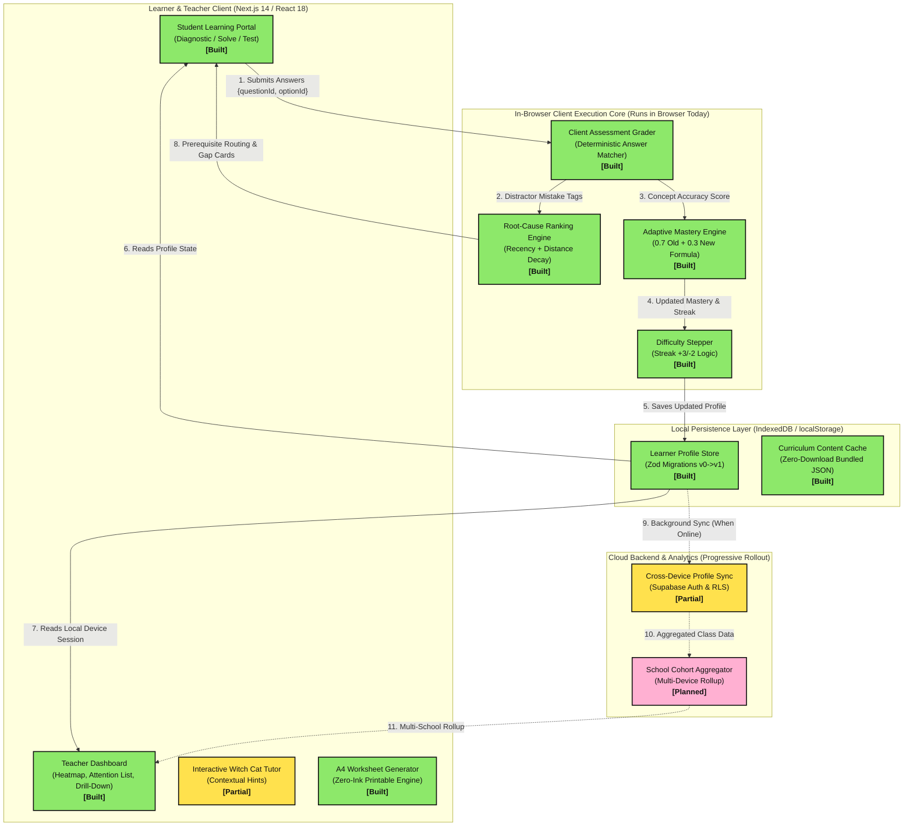

# Margam System Architecture & Data Flow

This document details the software architecture, component boundaries, runtime execution model, and data flows of the **Margam Adaptive Learning System**.

---

## 1. Architectural Principles & Guarantees

1. **Client-Side Grading (Zero Latency & Offline-First)**:
   > **CRITICAL ARCHITECTURAL GUARANTEE: Grading runs entirely in the browser today.**
   > All question evaluation, misconception tagging, candidate root-cause ranking, and adaptive mastery updates run locally on the learner's device inside the browser runtime. This ensures instantaneous feedback with **zero network latency** and allows Margam to operate in low-bandwidth Indian rural classrooms.

2. **Deterministic Adaptation**:
   No black-box or non-deterministic AI models gate student progression. All diagnostic scoring, difficulty adjustments, and prerequisite routing follow mathematical decay formulas and verified DAG traversals.

3. **Status Transparency**:
   Every component in the architecture is strictly classified into one of three implementation states:
   - **`[Built]`**: Fully implemented, validated by automated suites, and actively running in the application.
   - **`[Partial]`**: Core logic implemented locally with initial UI; cloud synchronization or secondary workflows pending.
   - **`[Planned]`**: Designed in specifications and schemas, scheduled for future implementation.

---

## 2. High-Level Presentation Architecture

This diagram illustrates the high-level system layers, from student interaction to curriculum storage.



---

## 3. Detailed Technical Architecture with Labelled Data Flows

This detailed technical diagram outlines the end-to-end data lifecycle from input submission, tag lookup, ranking mathematics, DAG ancestry traversal, to storage and dashboard presentation.

```mermaid
sequenceDiagram
    autonumber
    actor Learner as Learner (Browser Device)
    participant UI as Diagnostic UI [Built]
    participant Grader as In-Browser Grader [Built]
    participant TagRoots as Tag-Roots Map [Built]
    participant Ranker as Ranking Engine [Built]
    participant DAG as Prerequisite DAG (edgeMeta) [Built]
    participant Store as Local Storage & Zod Validator [Built]
    participant Teacher as Teacher Dashboard [Built]
    participant Cloud as Cloud Sync (Supabase) [Partial]

    Note over Learner,Grader: NOTE: All grading runs 100% in the browser runtime today

    Learner->>UI: Selects option 'A' on Question q-c10-form-01
    UI->>Grader: evaluateChapterDiagnostic(chapterId, answers)
    
    activate Grader
    Grader->>Grader: Check studentAns === q.correctAnswer
    Grader->>TagRoots: Fetch mistakeTag ('squared_negative_b_as_negative')
    TagRoots-->>Grader: Root concept 'c7-int-02'
    
    Grader->>Ranker: rankCandidateRootCauses(errorEvents, anchorConceptId)
    activate Ranker
    Ranker->>Ranker: Compute w_recency = 0.90^(N - 1 - i)
    Ranker->>Ranker: Add direct root score (1.0 * w_recency)
    Ranker->>DAG: getPrerequisitesGraph('c7-int-02', maxDepth=3)
    DAG-->>Ranker: Return ancestors [c7-int-01 (d=1), c6-neg-02 (d=2), c6-neg-01 (d=3)]
    Ranker->>Ranker: Add distance decay scores (0.70^d * w_recency)
    Ranker->>Ranker: Apply threshold (score >= 1.10) & tie-break on depth
    Ranker->>DAG: findPrerequisitePath('c10-quad-01', 'c7-int-02')
    DAG-->>Ranker: Return [c10-quad-01 -> c9-id-02 -> c7-int-02]
    Ranker-->>Grader: CandidateRootCause { conceptId: 'c7-int-02', score: 1.54, conf: 'low', route: 'confirmation_only' }
    deactivate Ranker

    Grader->>Store: updateMastery(oldMastery, newScore) & updateTopicProgress()
    activate Store
    Store->>Store: Validate schema via LearnerProfileSchema (Zod v1)
    Store->>Store: Persist to localStorage['margam_learner_profile_v1']
    Store-->>Grader: Persistence confirmed
    deactivate Store

    Grader-->>UI: DiagnosticResult { score: 67%, gapAnalysis, recommendedLessonConceptId }
    deactivate Grader

    UI-->>Learner: Render Confirmation Probe or Remedial Gap Card

    opt Teacher Inspection
        Teacher->>Store: getActiveProfile() (This Device Section)
        Store-->>Teacher: Active Local Learner Profile
        Teacher->>Teacher: Load data/synthetic-class.json (25 engine-generated profiles)
        Teacher-->>Teacher: Render Heatmap Matrix (M/P/G/L), Attention Alert, Evidence Drill-Down
    end

    opt Background Cloud Synchronization [Partial]
        Store-.>>Cloud: Push learner profile diff (Supabase anon client)
        Cloud-->>Store: Acknowledge sync timestamp
    end
```

---

## 4. Component Inventory & Status Matrix

| Component Layer | Module / File Path | Responsibility | Implementation Status | Runtime Location |
|---|---|---|---|---|
| **Curriculum Catalogue** | `data/chapters.json`<br/>`src/lib/curriculum.ts` | 67 NCERT chapters, 15 full pilot chapters across Classes 6 to 10 | **`[Built]`** | Bundled static JSON |
| **Prerequisite DAG & Meta** | `data/concepts.json`<br/>`src/lib/graph.ts` | 20 pilot chain concepts, strict acyclicity checking, `edgeMeta` with pedagogical reasons and tentative statuses | **`[Built]`** | Bundled static JSON |
| **Question Bank & Distractors** | `data/questions.json` | 86 original questions with calibrated mistake tags on all distractors | **`[Built]`** | Bundled static JSON |
| **Tag Roots Directory** | `data/tag-roots.json` | 167 mistake tags mapped to foundational root concepts | **`[Built]`** | Bundled static JSON |
| **Client Diagnostic Grader** | `src/lib/adaptive.ts`<br/>`evaluateChapterDiagnostic` | Evaluates student answers, tags errors, calculates accuracy percentage | **`[Built]`** | **Client Browser** |
| **Root Cause Ranker** | `src/lib/adaptive.ts`<br/>`rankCandidateRootCauses` | Computes exponential recency ($0.9^k$) and graph distance decay ($0.7^d$) scores | **`[Built]`** | **Client Browser** |
| **Adaptive Mastery Engine** | `src/lib/adaptive.ts`<br/>`updateMastery` | Pure formula: direct on attempt 1, $0.7 \cdot \text{old} + 0.3 \cdot \text{new}$ on subsequent attempts | **`[Built]`** | **Client Browser** |
| **Difficulty Stepper** | `src/lib/adaptive.ts`<br/>`updateConceptDifficulty` | Deterministic stepping: promote after 3 consecutive correct, demote after 2 incorrect | **`[Built]`** | **Client Browser** |
| **Storage & Zod Migration** | `src/lib/storage.ts` | Multi-grade profile isolation, v0 to v1 schema migration, corrupted profile safe reset | **`[Built]`** | Browser localStorage / memory |
| **Teacher Dashboard** | `src/app/teacher/page.tsx`<br/>`data/synthetic-class.json` | 25-student cohort aggregation, concept heatmap with (M, P, G, L) letters + colors, common misconceptions, evidence drill-down, "this device" card | **`[Built]`** | **Client Browser** |
| **A4 Printable Generator** | `src/app/teacher/page.tsx`<br/>(Print tab) | Clean, zero-ink printable remedial worksheets for low-connectivity classrooms | **`[Built]`** | **Client Browser** |
| **Interactive Tutor Cat** | `src/components/ui/WitchCat.tsx` | Character animations and reactive emotional feedback | **`[Partial]`** | Client Browser |
| **Cloud Authentication** | `src/lib/supabase/client.ts`<br/>`src/lib/flags.ts` | Supabase auth integration (gated behind `FEATURE_LOGIN` flag) | **`[Partial]`** | Client / Supabase Auth |
| **Multi-School Cloud Sync** | `src/lib/supabase/` | Real-time school aggregation and government reporting rollups | **`[Planned]`** | Cloud Postgres / Edge Functions |

---

## 5. Why Browser-Side Grading is Critical for Margam

Running grading inside the client browser is not a temporary shortcut; it is a core architectural choice designed specifically for Indian education realities:

1. **Zero Data Costs for Schools**:
   Indian government schools often operate on limited 2G/3G mobile hotspots or shared dongles. Evaluating tests in the browser means students can complete entire chapters without consuming recurring API bandwidth.
2. **Instant Feedback**:
   Students see immediate hints, mistake tags, and adaptive lesson recommendations without waiting for server round-trips or cold-start cloud function delays.
3. **Data Privacy by Default**:
   Student answers, roll numbers, and preliminary diagnostics stay on the device until explicit teacher or parent consent is given for cloud sync.
